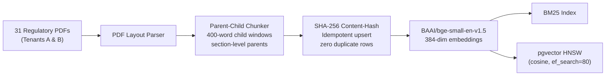
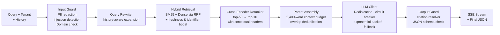

# Production RAG — Regulatory Compliance Engine

A retrieval-augmented generation service answering questions over a frozen corpus of Indian banking and payments regulations (RBI, NPCI, MeitY). Built with FastAPI, hybrid BM25 + dense retrieval, cross-encoder reranking, multi-tenant isolation, multi-layer guardrails, and per-stage tracing.

**Repository:** `https://github.com/Tanvi-Ghadge/production-rag.git`

---

## Why Regulatory RAG Is Hard

Standard RAG pipelines fail on compliance corpora in predictable ways:

| Problem | Root Cause | This System's Response |
|---|---|---|
| Exact identifiers missed | Dense models dilute `Section 10(2)`, `V-CIP`, circular numbers into generic vectors | BM25 + density fusion with regex identifier boost |
| Superseded rules cannot be deleted | Historical audits require older versions; retriever must surface active rules first | Freshness boost + multi-version supersession chains in corpus |
| Context fragments lose legal exceptions | Small chunks miss surrounding provisos and conditions | Parent-child chunking; parent expansion at assembly time |
| Unsupported answers cause liability | Hallucinated citations are worse than refusals in compliance | Multi-layer guardrails; citation resolver validates every `chunk_id` |

---

## Architecture

### Offline Ingestion



### Online Serving — `POST /v1/ask`



---

## What Was Built

### 1. Corpus & Idempotent Ingestion

**Corpus (`corpus-2026-11-09`):** 31 public Indian regulatory PDFs across two tenants — Tenant A (18 docs, 1,983 chunks) and Tenant B (13 docs, 3,046 chunks), totalling **5,029 child chunks**. The corpus includes five multi-version supersession chains: `pa_guidelines_2020 → pa_md_2025`, `kyc_md_2016 → kyc_md_2025`, `cyber_md_2024 → cyber_md_2026`, `ppi_md_2017 → ppi_md_2021`, and `emandate_2022 → 2026`. See [docs/corpus.md](docs/corpus.md).

**Structure-aware parent-child chunking** (`ingest/chunker.py`): section-level parent chunks with 400-word child windows. Re-running ingestion on an unchanged corpus produces zero new rows; chunks are addressed by SHA-256 hash.

### 2. Hybrid Retrieval, Freshness & Reranking

- **Custom BM25** (`retrieval/bm25.py`) paired with `BAAI/bge-small-en-v1.5` dense vectors, fused with Reciprocal Rank Fusion (RRF). Both local index and PostgreSQL `pgvector` HNSW backends are supported (`deploy/pgvector-init.sql`).
- **Boosts**: `+0.002` freshness bonus for documents not superseded; regex identifier boost for `Section`, `Rule`, `Form`, and circular IDs.
- **Cross-encoder reranking** (`retrieval/rerank.py`): `BAAI/bge-reranker-base` reranks the top-50 hybrid candidates down to top-10. Contextual section headers prepended to chunks (e.g. `[kyc_md_2025 > 15.3 PPI issuers]`) are critical — without them, reranking degrades performance (see ablations below).
- **Tenant isolation**: `tenant`, `effective_after`, and `effective_before` filters applied at retrieval time and re-enforced before parent assembly. Zero cross-tenant leakage confirmed across a 40-query probe.

### 3. Generation, Caching & Resilience

- **Context assembly** (`query/assemble.py`): child chunks expanded to parent sections, overlapping parents deduplicated, context capped at 2,400 words.
- **XML-delimited grounding** (`guard/context.py`): retrieved chunks wrapped in `<document chunk_id="...">` tags and treated as untrusted input to the prompt.
- **Guardrails:**
  - *Input* (`guard/input_guard.py`, `guard/redact.py`): redacts Aadhaar, PAN, IFSC, email, phone, and bank account numbers before any further processing; blocks prompt injection, jailbreak, delimiter, and Hindi/Hinglish injection patterns; second-layer borderline-intent check (LLM-backed with `RAG_LLM_GUARD=1`, deterministic scoring offline); refuses out-of-domain queries.
  - *Output* (`guard/output_guard.py`): JSON schema validation; every cited `chunk_id` verified against the queried tenant's index.
- **LLM client** (`llm/client.py`): 30 s per-provider timeout; exponential backoff with jitter; stateful circuit breaker (opens for 30 s after 3 consecutive failures); multi-provider fallback (Foundry / Cohere `command-r-08-2024` → deterministic extractive fallback); Redis `ExactCache` (`llm/cache.py`); optional `SemanticCache` (`RAG_SEMANTIC_CACHE=1`).

### 4. FastAPI Service & Observability

**Endpoints** (`app/main.py`): `POST /v1/ask` (SSE streaming), `POST /v1/ingest`, `GET /v1/ingest/{job_id}`, `POST /v1/feedback`, `GET /v1/health`.

- `X-API-Key` header authentication with sliding-window rate limiting (60 req/min per key).
- FastAPI `lifespan` pre-loads the sentence transformer, BM25 index, and tenant lookup maps; a warm-up query fires before the first real request. `psycopg` connections are persistent and thread-safe; query embedding LRU cache is held in memory (`persist_cache=False` online).
- Per-stage tracing via `observability/` captures wall-clock time for each pipeline stage and reports p50/p95 percentiles.

---

## Latency

Profiling identified two root causes for the original `43 s` end-to-end p50: `SentenceTransformer` loading on first request (`49.8 s`) and `psycopg.connect()` issued per query. Both were moved to startup.

**Steady-state benchmark** — 200 queries, 10 warm-up requests discarded, benchmark script cycles 25 sample questions 8 times, so the `retrieve` p50 is **embedding-cache warm** (`evals/results/latency-after.json`):

| Stage | Before p50 | Before p95 | After p50 | After p95 |
|---|---:|---:|---:|---:|
| `input_guard` | 0.70 ms | 1.46 ms | 0.12 ms | 0.18 ms |
| `retrieve` | 40,493 ms | 55,122 ms | **58.98 ms** | 81.34 ms |
| `rerank` | — | — | 3.37 ms | 5.87 ms |
| `assemble` | 1,918 ms | 1,970 ms | **0.13 ms** | 0.29 ms |
| `generate` | 97 ms | 14,087 ms | 30.01 ms | 3,003 ms |
| **End-to-end** | **43,402 ms** | **61,399 ms** | **151.5 ms** | **3,206 ms** |

- **Cold start** (FastAPI lifespan, isolated): 39,980 ms.
- **Cache hit rate**: 92.5% exact Redis cache hit rate; p95 reflects cold live Cohere API calls.
- **Unprofiled gap**: 58.9 ms between individual stage sum (92.6 ms) and end-to-end wall-clock (151.5 ms) is not profiled; likely framework and streaming overhead.
- **pgvector**: `EXPLAIN ANALYZE` confirms `Index Scan using chunks_embedding_hnsw_idx` (`vector_cosine_ops`, `<=>`) at 2.03 ms.

---

## Evaluation

> [!IMPORTANT]
> **Evaluation audit (2026-11-13):** 40 of the original 90 factoid questions quoted section headings verbatim (e.g. `"what requirement is stated in '15.3 PPI issuers…'"`), causing BM25 and contextual-header retrieval to match via exact string overlap rather than semantic relevance. All 40 were rewritten as natural questions derived from gold passage text only ([evals/golden/CHANGELOG.md](evals/golden/CHANGELOG.md)). Five malformed questions were purged after hand-checking. The final golden set is **160 questions** (130 answerable: 94 dev / 36 test, plus 15 unanswerable and 15 adversarial in dev). The contaminated ablation run (Run 004 in [evals/results/results_log.md](evals/results/results_log.md)) is preserved but invalidated.
>
> Generation metrics (faithfulness, correctness, citation, refusal) on the **cleaned** question set: **not measured**.

### Retrieval Ablations — Dev Split (n = 94 answerable, clean)

Nine configurations evaluated on the frozen dev split with leakage eliminated. Primary metric: Recall@5 (strict chunk-level match). 95% Wilson confidence intervals from [evals/results/ablations_lean.json](evals/results/ablations_lean.json).

| Configuration | R@5 | 95% CI | Doc@5 | R@20 | MRR |
|---|---:|:---:|---:|---:|---:|
| Dense only (`bge-small`) | 0.5053 | [0.406, 0.604] | 0.8105 | 0.5895 | 0.3932 |
| BM25 only | 0.6632 | [0.563, 0.750] | 0.9158 | 0.7579 | 0.5704 |
| Hybrid baseline (BM25 + dense, RRF) | 0.6211 | [0.521, 0.712] | 0.8947 | 0.6947 | 0.4611 |
| + identifier boost | 0.6526 | [0.553, 0.741] | 0.9474 | 0.7789 | 0.5259 |
| + rerank top-20 → 10 | 0.6000 | [0.499, 0.693] | 0.8842 | 0.6316 | 0.4507 |
| + rerank top-50 → 10 | 0.5895 | [0.489, 0.683] | 0.9368 | 0.6211 | 0.4393 |
| + id boost + rerank top-50 → 10 | 0.6105 | [0.510, 0.703] | 0.9579 | 0.6632 | 0.4586 |
| + contextual headers | 0.6421 | [0.542, 0.731] | 0.9053 | 0.7263 | 0.5122 |
| **+ contextual headers + rerank top-50 → 10 ✓** | **0.7474** | **[0.652, 0.824]** | **0.9789** | **0.7684** | **0.6575** |

**Key findings:**

- **Reranking requires contextual headers.** Vanilla reranking on short regulatory fragments *hurt* performance (hybrid 0.6211 → 0.5895): the cross-encoder penalised context-free fragments. Prepending `[document_id > section_path]` to each chunk before reranking reversed this, raising R@5 by +12.6pp to 0.7474.
- **BM25 outperforms naive dense and hybrid baseline.** BM25 alone (0.6632) beats `bge-small` dense (0.5053) and baseline hybrid (0.6211) on this corpus. Indian regulatory text contains high-discrimination lexical identifiers (`Section 10(2)`, `V-CIP`, `PPI`, `TPAP`) that small dense models dilute.
- **Confidence intervals of winner and BM25 overlap.** The 95% CIs of the winning config [0.652, 0.824] and BM25 alone [0.563, 0.750] overlap — the difference is suggestive, not definitively established at this sample size.

**Dev category breakdown (winning config):**

| Category | n | R@5 |
|---|---:|---:|
| Factoid | 35 | 0.9143 |
| Table lookup | 21 | 0.8095 |
| Multi-hop | 21 | 0.6190 |
| Version-sensitive | 18 | 0.5000 |

### Test Split — Locked, Evaluated Once

Winning configuration (`+ctx_headers +rerank top-50→10`) evaluated once on the 36 locked test questions ([evals/results/test_eval.json](evals/results/test_eval.json)):

| Metric | Value | 95% Wilson CI |
|---|---:|:---:|
| Recall@5 | **0.7500** (27/36) | [0.589, 0.863] |
| Document Recall@5 | 0.9722 | — |
| Recall@20 | 0.7778 | — |
| MRR | 0.6655 | — |

Category breakdown on test: factoid 0.9286, multi-hop 0.7778, table-lookup 0.6667, version-sensitive 0.4286. Dev and test R@5 are within 0.3pp (0.7474 vs. 0.7500), indicating no dev overfitting.

### Legacy Generation Metrics (Pre-Audit, 120-Question Run)

> [!NOTE]
> Evaluated 2026-11-11 on the pre-audit question set. These numbers predate the leakage rewrite and have **not been rerun** on the cleaned set. Reported for completeness only; do not compare directly to the retrieval ablations above.

From [evals/results/answers.json](evals/results/answers.json) and [evals/results/calibration.json](evals/results/calibration.json):

| Category | n | Faithfulness | Correctness | Refusal Acc. | Citation Acc. |
|---|---:|---:|---:|---:|---:|
| Factoid | 40 | 1.0000 | 0.3969 | 1.0000 | 0.6000 |
| Multi-hop | 20 | 0.9000 | 0.2551 | 1.0000 | 0.5000 |
| Table lookup | 15 | 1.0000 | 0.2260 | 1.0000 | 0.2667 |
| Version-sensitive | 15 | 1.0000 | 0.5561 | 1.0000 | 0.6000 |
| Unanswerable | 15 | 1.0000 | 1.0000 | 1.0000 | 1.0000 |
| Adversarial | 15 | 1.0000 | 1.0000 | 1.0000 | 1.0000 |
| **Overall** | **120** | **0.9833** | **0.5226** | **1.0000** | **0.6417** |

**Failure taxonomy (58 incorrect answers, legacy run):**
- 45 (77.6%) — Correct document retrieved; strict chunk-level mismatch or neighbour-section penalty (`39/58` scored by lexical fallback, not LLM judge).
- 10 (17.2%) — True retrieval miss; worst in `table_lookup` and `multi_hop`.
- 3 (5.2%) — Superseded document version cited.

**Judge calibration** (`evals/calibrate.py`, 65-item key-facts rubric):
- Faithfulness kappa: 1.0000 — uninformative; all 65/65 labeled items are faithful.
- Correctness kappa: 0.5522 (moderate agreement); observed correctness agreement 0.8154.

---

## Guardrails & Red-Team

From [redteam/redteam.md](redteam/redteam.md) and [evals/results/redteam-after.json](evals/results/redteam-after.json) — 59 suite test cases (45 adversarial attack probes + 14 failure/resilience cases) plus 100 benign queries:

**0 of 45 attacks succeeded. 1 of 100 benign queries was blocked (1.0% false-positive rate).**

| Configuration | Attack Success Rate | Benign FPR |
|---|---:|---:|
| No guardrails | 100.0% | 0.0% |
| Single-regex baseline | 62.2% | 0.0% |
| **Multi-layer guardrails (current)** | **0.0%** | **1.0%** |

Failure-mode verification ([evals/results/failure-modes.json](evals/results/failure-modes.json)): 5/5 degraded-operation scenarios passed (Cohere outage, Redis outage, pgvector outage, reranker outage, malformed provider output).

---

## Setup

```bash
git clone https://github.com/Tanvi-Ghadge/production-rag.git
cd production-rag

python -m venv .venv
# Windows: .\.venv\Scripts\Activate.ps1
# Linux/macOS: source .venv/bin/activate
pip install -r requirements.txt

cp .env.example .env
docker compose -f deploy/docker-compose.pgvector.yml up -d

python -m ingest.run          # local BM25 + embedding index
python -m ingest.pgvector_run # pgvector HNSW index
uvicorn app.main:app --host 0.0.0.0 --port 8000 --reload
```

### Evaluation Commands

```bash
python -m evals.ci_gate                   # CI regression gate (Recall@5 ≥ 0.7174)
python -m redteam.run                     # 59-case red-team + 100-query FPR
python -m evals.calibrate                 # 65-item key-facts judge calibration
python -m observability.benchmark_latency # 200-query steady-state latency benchmark
python -m evals.run_ablations             # Retrieval ablation suite (9 configs)
python -m pytest tests/ -v                # Unit and integration tests
```

---

## Repository Layout

```
app/            FastAPI service — lifespan warmup, routes, auth, rate limiting
corpus/         31 public Indian regulatory PDFs (Tenants A & B) and manifest
data/index/     Content-addressed chunk store, BM25 index, embedding cache
deploy/         Dockerfile, pgvector + Redis Compose stack, cloud notes
docs/           Corpus policy, decision log, failure taxonomy, architecture notes
evals/          Golden set (160 Q, dev/test split), ablation scripts, CI gate
guard/          PII redaction, injection detection, domain check, output guard
ingest/         PDF parser, parent-child chunker, embedder, indexers
llm/            LLMClient — circuit breaker, retries, Redis & semantic caches
observability/  Per-stage tracing, percentile reporting, latency benchmark
query/          Query rewriter, parent context assembly, generation
redteam/        45-probe adversarial suite + 100-query false-positive benchmark
retrieval/      BM25 index, dense vector index, hybrid RRF, cross-encoder reranker
tests/          API, ingestion, retrieval, guardrail, and pgvector contract tests
```

---

## Verification Summary

| # | Test | Status | Evidence |
|---|---|:---:|---|
| 1 | Idempotent ingestion | PASS | SHA-256 dedupe in `ingest/indexer.py`; `changed == 0` on re-run |
| 2 | Citation resolution & refusals | PASS (legacy) | 1.0000 refusal acc., 0.6417 citation acc. on pre-audit run; clean set not re-measured |
| 3 | Tenant isolation | PASS | Zero cross-tenant leakage across 40-query probe; Tenant A 1,983 chunks, Tenant B 3,046 chunks |
| 4 | Version sensitivity | KNOWN WEAKNESS | 50.0% newest-document preference on version-sensitive dev questions (9/18) |
| 5 | Red-team & attack metrics | PASS | 0 of 45 attacks succeeded; 1.0% benign false-positive rate |
| 6 | LLM fallback & circuit breaker | PASS | 30 s timeout, exponential backoff, circuit breaker after 3 failures, deterministic fallback |
| 7 | Latency & cache | PASS | Retrieve p50 = 59 ms (cache warm); end-to-end p50 = 151.5 ms; 92.5% cache hit rate |
| 8 | Judge calibration | PASS | Correctness kappa = 0.5522 (moderate); faithfulness kappa uninformative (65/65 faithful) |
| 9 | CI regression gate | PASS | `evals.ci_gate` passes at Recall@5 = 0.7474; enforces max −3pp regression |
