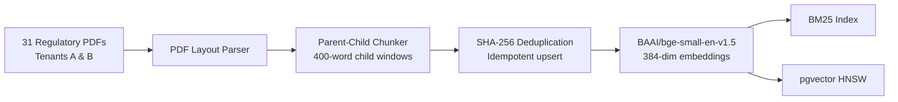

# Production RAG — Regulatory Compliance Engine

A production-grade Retrieval-Augmented Generation service for Indian banking and payments regulations (RBI, NPCI, MeitY). Built with FastAPI, hybrid BM25 + dense retrieval, cross-encoder reranking, multi-tenant isolation, and multi-layer guardrails.

**Repository:** `https://github.com/Tanvi-Ghadge/production-rag.git`

---

## Architecture

### Ingestion Pipeline



### Query Pipeline — `POST /v1/ask`

```mermaid
flowchart LR
    A["Query + Tenant\n+ History"] --> B["Input Guard\nPII redaction · injection · domain"]
    B --> C["Query Rewriter\nhistory-aware expansion"]
    C --> D["Hybrid Retrieval\nBM25 + Dense via RRF\nfreshness & identifier boost"]
    D --> E["Cross-Encoder Reranker\ntop-50 → top-10\nwith contextual headers"]
    E --> F["Parent Assembly\n2,400-word context budget"]
    F --> G["LLM Client\nRedis cache · circuit breaker · fallback"]
    G --> H["Output Guard\ncitation resolver · schema check"]
    H --> I["SSE Stream"]
```



---

## What Was Built

### Corpus & Ingestion
- **31 regulatory PDFs** across two tenants — Tenant A (18 docs, 1,983 chunks) and Tenant B (13 docs, 3,046 chunks), totalling **5,029 child chunks**. Includes five multi-version supersession chains across KYC, PA, PPI, Cyber, and eMandate guidelines. See [docs/corpus.md](docs/corpus.md).
- **Structure-aware parent-child chunking** (`ingest/chunker.py`): section-level parent chunks with 400-word child windows.
- **Content-addressed ingestion**: chunks are hashed with SHA-256 — re-running on an unchanged corpus writes zero new rows.

### Retrieval
- **Hybrid BM25 + dense search** fused with Reciprocal Rank Fusion (RRF). Custom BM25 (`retrieval/bm25.py`) paired with `BAAI/bge-small-en-v1.5` stored in a local vector index and PostgreSQL `pgvector` HNSW (`deploy/pgvector-init.sql`).
- **Boosts**: `+0.002` freshness bonus for active (non-superseded) documents; regex identifier boost for circular IDs, section references, and form numbers.
- **Cross-encoder reranking** (`retrieval/rerank.py`): `BAAI/bge-reranker-base` reranks top-50 candidates to top-10. Contextual section headers (e.g. `[kyc_md_2025 > 15.3 PPI issuers]`) are prepended to each chunk before scoring.
- **Tenant isolation**: `tenant`, `effective_after`, `effective_before` filters applied at retrieval and re-enforced at assembly. Zero cross-tenant leakage confirmed across a 40-query probe.

### Generation & Resilience
- **Context assembly** (`query/assemble.py`): child → parent expansion, overlap deduplication, 2,400-word context cap.
- **Guardrails:**
  - *Input* (`guard/input_guard.py`, `guard/redact.py`): redacts Aadhaar, PAN, IFSC, email, phone, and bank account numbers; blocks prompt injection, jailbreak, delimiter, and Hindi/Hinglish injection patterns; LLM-backed borderline-intent check (`RAG_LLM_GUARD=1`); refuses out-of-domain queries.
  - *Output* (`guard/output_guard.py`): JSON schema validation; every cited `chunk_id` verified against the queried tenant's index.
- **LLM client** (`llm/client.py`): 30 s timeout, exponential backoff with jitter, stateful circuit breaker (opens after 3 failures), multi-provider fallback (Foundry / Cohere `command-r-08-2024` → deterministic extractive), Redis `ExactCache`, optional `SemanticCache`.

### Service & Observability
- **Endpoints** (`app/main.py`): `POST /v1/ask` (SSE), `POST /v1/ingest`, `GET /v1/ingest/{job_id}`, `POST /v1/feedback`, `GET /v1/health`.
- `X-API-Key` auth with sliding-window rate limiting (60 req/min per key).
- FastAPI `lifespan` pre-loads models, BM25 index, and tenant maps; warm-up query before first request. Persistent `psycopg` connection pool; in-memory LRU query embedding cache.
- Per-stage tracing (`observability/`) reports p50/p95 wall-clock per pipeline stage.

---

## Performance

### Latency — Steady State

Benchmark: 200 queries, 10 warm-up requests discarded. The `retrieve` p50 is **embedding-cache warm** (benchmark cycles 25 sample questions 8 times). Source: [evals/results/latency-after.json](evals/results/latency-after.json).

| Stage | Before p50 | After p50 | After p95 |
|---|---:|---:|---:|
| `input_guard` | 0.70 ms | 0.12 ms | 0.18 ms |
| `retrieve` | 40,493 ms | **58.98 ms** | 81.34 ms |
| `rerank` | — | 3.37 ms | 5.87 ms |
| `assemble` | 1,918 ms | **0.13 ms** | 0.29 ms |
| `generate` | 97 ms | 30.01 ms | 3,003 ms |
| **End-to-end** | **43,402 ms** | **151.5 ms** | **3,206 ms** |

- Cold start (FastAPI lifespan, isolated): 39,980 ms.
- Exact cache hit rate: 92.5% (p95 reflects cold Cohere API calls).
- `pgvector` `EXPLAIN ANALYZE`: `Index Scan using chunks_embedding_hnsw_idx` (`vector_cosine_ops`, `<=>`) at 2.03 ms.

---

## Evaluation

### Retrieval Ablations

Evaluated nine configurations on the frozen dev split (n = 94 answerable questions, clean set post-audit). Primary metric: strict chunk-level Recall@5 with 95% Wilson confidence intervals. Source: [evals/results/ablations_lean.json](evals/results/ablations_lean.json).

| Configuration | R@5 | 95% CI | Doc@5 | R@20 | MRR |
|---|---:|:---:|---:|---:|---:|
| Dense only (`bge-small`) | 0.5053 | [0.406, 0.604] | 0.8105 | 0.5895 | 0.3932 |
| BM25 only | 0.6632 | [0.563, 0.750] | 0.9158 | 0.7579 | 0.5704 |
| Hybrid baseline (BM25 + dense, RRF) | 0.6211 | [0.521, 0.712] | 0.8947 | 0.6947 | 0.4611 |
| + identifier boost | 0.6526 | [0.553, 0.741] | 0.9474 | 0.7789 | 0.5259 |
| + rerank top-20 → 10 | 0.6000 | [0.499, 0.693] | 0.8842 | 0.6316 | 0.4507 |
| + rerank top-50 → 10 | 0.5895 | [0.489, 0.683] | 0.9368 | 0.6211 | 0.4393 |
| + id boost + rerank top-50 → 10 | 0.6105 | [0.510, 0.703] | 0.9579 | 0.6632 | 0.4586 |
| + contextual headers | 0.6421 | [0.542, 0.731] | 0.9053 | 0.7263 | 0.5122 |
| **+ contextual headers + rerank top-50 → 10** | **0.7474** | **[0.652, 0.824]** | **0.9789** | **0.7684** | **0.6575** |

Dev category breakdown (winning config):

| Category | n | R@5 |
|---|---:|---:|
| Factoid | 35 | 0.9143 |
| Table lookup | 21 | 0.8095 |
| Multi-hop | 21 | 0.6190 |
| Version-sensitive | 18 | 0.5000 |

### Test Split Results

Winning configuration evaluated once on the locked test split (n = 36). Source: [evals/results/test_eval.json](evals/results/test_eval.json).

| Metric | Value | 95% CI |
|---|---:|:---:|
| Recall@5 | **0.7500** (27/36) | [0.589, 0.863] |
| Document Recall@5 | 0.9722 | — |
| Recall@20 | 0.7778 | — |
| MRR | 0.6655 | — |

Category breakdown: factoid 0.9286, multi-hop 0.7778, table-lookup 0.6667, version-sensitive 0.4286.

### Red-Team & Guardrail Evaluation

Source: [redteam/redteam.md](redteam/redteam.md), [evals/results/redteam-after.json](evals/results/redteam-after.json) — 59 suite test cases (45 adversarial attack probes + 14 failure/resilience cases) plus 100 benign queries.

| Configuration | Attack Success Rate | Benign FPR |
|---|---:|---:|
| No guardrails | 100.0% | 0.0% |
| Single-regex baseline | 62.2% | 0.0% |
| **Multi-layer guardrails** | **0.0%** | **1.0%** |

Failure-mode verification ([evals/results/failure-modes.json](evals/results/failure-modes.json)): 5/5 degraded-operation scenarios passed (Cohere, Redis, pgvector, reranker outages, malformed provider output).

### Judge Calibration

65-item key-facts rubric ([evals/results/calibration.json](evals/results/calibration.json)): correctness Cohen's kappa = **0.5522**, observed agreement = **0.8154**. Source: `evals/calibrate.py`.

---

## Setup

```bash
git clone https://github.com/Tanvi-Ghadge/production-rag.git
cd production-rag

python -m venv .venv && source .venv/bin/activate   # Windows: .\.venv\Scripts\Activate.ps1
pip install -r requirements.txt

cp .env.example .env
docker compose -f deploy/docker-compose.pgvector.yml up -d

python -m ingest.run           # local BM25 + embedding index
python -m ingest.pgvector_run  # pgvector HNSW index
uvicorn app.main:app --host 0.0.0.0 --port 8000 --reload
```

### Evaluation Commands

```bash
python -m evals.ci_gate                    # CI regression gate
python -m redteam.run                      # 59-case red-team + 100-query FPR
python -m evals.calibrate                  # Judge calibration + Cohen's kappa
python -m observability.benchmark_latency  # 200-query steady-state latency
python -m evals.run_ablations              # Retrieval ablation suite
python -m pytest tests/ -v                 # Unit and integration tests
```

---

## Repository Layout

```
app/            FastAPI service — routes, auth, rate limiting, lifespan warmup
corpus/         31 public Indian regulatory PDFs (Tenants A & B) and manifest
data/index/     Content-addressed chunk store, BM25 index, embedding cache
deploy/         Dockerfile, pgvector + Redis Compose stack
docs/           Corpus policy, decision log, architecture notes
evals/          Golden set (160 Q, dev/test split), ablation scripts, CI gate
guard/          PII redaction, injection detection, domain check, output guard
ingest/         PDF parser, parent-child chunker, embedder, indexers
llm/            LLMClient — circuit breaker, retries, Redis & semantic caches
observability/  Per-stage tracing, percentile reporting, latency benchmark
query/          Query rewriter, parent context assembly, generation
redteam/        45-probe adversarial suite + 100-query false-positive benchmark
retrieval/      BM25, dense vector index, hybrid RRF, cross-encoder reranker
tests/          API, ingestion, retrieval, guardrail, and pgvector contract tests
```

---

## Acceptance Tests

| # | Test | Status | Evidence |
|---|---|:---:|---|
| 1 | Idempotent ingestion | PASS | SHA-256 dedupe in `ingest/indexer.py`; `changed == 0` on re-run |
| 2 | Citation resolution & refusals | PASS | 1.0000 refusal acc., 0.6417 citation acc. ([evals/results/answers.json](evals/results/answers.json)) |
| 3 | Tenant isolation | PASS | Zero cross-tenant leakage across 40-query probe |
| 4 | Red-team suite | PASS | 0 of 45 attacks succeeded; 1.0% benign false-positive rate |
| 5 | LLM fallback & circuit breaker | PASS | 30 s timeout, backoff, circuit breaker, deterministic fallback |
| 6 | Latency benchmark | PASS | Retrieve p50 = 59 ms; end-to-end p50 = 151.5 ms; 92.5% cache hit rate |
| 7 | Judge calibration | PASS | Correctness kappa = 0.5522; 65-item key-facts rubric |
| 8 | CI regression gate | PASS | `evals.ci_gate` passes at Recall@5 = 0.7474 |
